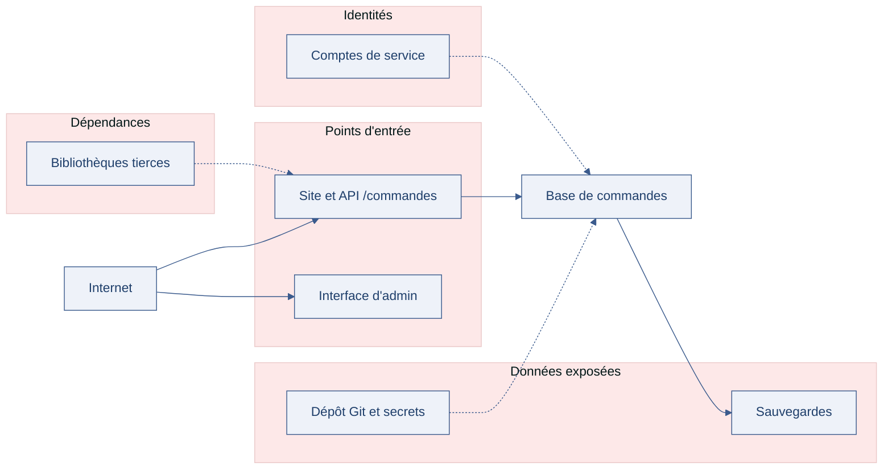

[← Chapitre précédent](02-securite-proportionnee.md) · [Sommaire](Readme.md) · [Chapitre suivant →](04-paysage-cyber.md)

# CID (Confidentialité, Intégrité, Disponibilité) et vocabulaire du risque — les mots pour parler du risque

> Un caissier de supermarché peut voler dans la caisse, modifier le prix d'un
> article, ou bloquer la caisse pendant une heure. Trois gestes, trois problèmes,
> trois mesures différentes. Pour en parler sans se comprendre de travers, il faut
> d'abord s'accorder sur les mots.

**Durée :** ≈ 20 min (lecture ≈ 12 min + atelier 5 min + réflexion et lecture de code) · **Prérequis :** [Sécurité proportionnée](02-securite-proportionnee.md)

---

## Objectifs

À l'issue de ce chapitre, vous serez capable de :

- **Distinguer** les trois piliers de la sécurité — CID (Confidentialité, Intégrité, Disponibilité) — sur un incident concret.
- **Différencier** vulnérabilité, menace, risque et impact, et les relier dans le bon ordre.
- **Construire** une chaîne menace → vulnérabilité → risque → impact à partir d'un scénario.
- **Cartographier** la surface d'attaque d'une application.

---

## I. CID — trois problèmes, trois mesures

Revenons au caissier. Trois gestes malhonnêtes, trois natures de problème :

| Ce que fait le caissier | Le problème posé | Le pilier touché |
| --- | --- | --- |
| Il se sert dans la caisse | quelque chose a été pris par qui n'en avait pas le droit | **Confidentialité** |
| Il modifie le prix affiché sur une étiquette | une information est devenue fausse | **Intégrité** |
| Il bloque la caisse pendant une heure | le service n'est plus rendu aux clients | **Disponibilité** |

En informatique, c'est exactement la même chose, avec des données :

- **Confidentialité** — seules les personnes autorisées accèdent à l'information.
  Exemple : un fichier de paie consulté par un tiers, une base clients copiée.
- **Intégrité** — l'information est exacte, complète, et n'a pas été altérée sans
  droit. Exemple : un prix modifié dans la base, un export quotidien corrompu en
  route vers l'entrepôt de données.
- **Disponibilité** — l'information et le service sont accessibles au moment où
  on en a besoin. Exemple : une boutique en ligne injoignable pendant les soldes,
  un tableau de bord bloqué le jour du comité de direction.

> [!TIP]
> Pour qualifier une atteinte, posez trois questions : qui a vu ce qu'il ne
> devait pas (confidentialité), qu'est-ce qui a été modifié ou détruit
> (intégrité), qu'est-ce qui n'est plus accessible (disponibilité). Un incident
> répond souvent aux trois.

Un même incident touche rarement un seul pilier. Un **rançongiciel** (logiciel qui
chiffre les données puis réclame une rançon) en est l'exemple type : les données
sont illisibles (disponibilité), elles ont souvent été copiées avant d'être
chiffrées (confidentialité), et leur contenu est altéré (intégrité).

> 🧪 **Atelier rapide (5 min)**
>
> Un rançongiciel chiffre les serveurs d'une clinique : les dossiers patients
> deviennent illisibles, les rendez-vous sont annulés, et l'attaquant affirme
> avoir copié les dossiers avant de frapper. Pour chaque pilier CID, dites s'il
> est touché et pourquoi, en une phrase. Un pilier que vous jugez épargné doit
> être justifié lui aussi.

---

## II. Vulnérabilité, menace, risque, impact

Dans le langage courant, « risque » sert à tout. En sécurité, quatre mots
chacun une place précise :

- **Menace** — ce qui peut causer un dommage : un attaquant, un groupe criminel,
  un logiciel automatisé, un ancien employé mécontent, une erreur humaine.
- **Vulnérabilité** — la faiblesse que la menace peut exploiter : un défaut de
  code, une configuration oubliée, un mot de passe partagé, une procédure absente.
- **Risque** — ce qui peut arriver quand une menace rencontre une vulnérabilité.
  On le juge sur deux axes : sa **probabilité** et sa **gravité**.
- **Impact** — la conséquence concrète si le risque se réalise : activité
  arrêtée, données fuitées, clients touchés, sanction éventuelle.

La chaîne se lit toujours dans le même sens :


Prenons un cas concret, tiré d'une plateforme d'analyse de données. Des exports
quotidiens de ventes sont déposés dans un compartiment de stockage d'objet
(MinIO) ouvert par erreur sur Internet :

| Élément | Dans le cas |
| --- | --- |
| **Menace** | un robot automatisé qui balaye Internet à la recherche de compartiments mal configurés |
| **Vulnérabilité** | le compartiment d'exports est accessible sans authentification |
| **Risque** | fuite des exports de ventes, qui contiennent des coordonnées clients |
| **Impact** | notification aux personnes concernées, perte de confiance, sanction possible |

Cette chaîne n'est pas qu'un vocabulaire : elle indique **où agir**. On traite
rarement la menace (empêcher qu'un robot existe n'est pas possible), on traite la
vulnérabilité (refermer le compartiment), et on réduit l'impact (chiffrer les
exports, minimiser les données qu'ils contiennent).

> [!WARNING]
> Une « menace » n'est pas un risque, et un « risque » n'est pas un impact.
> Mélanger ces mots fait basculer une discussion technique dans un débat sans
> fin : chacun défend une mesure différente parce qu'il ne parle pas de la même
> chose.

---

## III. Surface d'attaque

La **surface d'attaque**, c'est l'ensemble de ce qu'un attaquant peut atteindre,
toucher ou interroger. Elle ne se limite pas à la page de connexion : elle
commence dès qu'un élément est joignable, visible, ou devinable.

Quatre familles à passer en revue :

1. **Les points d'entrée techniques** — API (Application Programming Interface,
   interface de programmation) ouvertes, ports réseau, pages de connexion,
   fichiers téléchargeables, interfaces d'administration.
2. **Les données exposées** — messages d'erreur trop bavards, sauvegardes
   accessibles, fichiers de configuration, métadonnées.
3. **Les identités** — comptes oubliés, mots de passe par défaut, comptes de
   service trop puissants, comptes partagés.
4. **Les dépendances** — bibliothèques tierces non mises à jour, images de
   conteneurs périmées, services tiers abandonnés.

La carte ci-dessous pose ces quatre familles sur un système concret,
**DIGICHEESE** (l'entreprise d'étude du parcours) : chaque famille a ses
endroits à elle, et plusieurs convergent vers les mêmes données.



Un extrait suffit à voir le problème. Cette route d'API (FastAPI, en Python) est
parfaitement fonctionnelle — et parfaitement exposée :

```python
from fastapi import FastAPI

app = FastAPI()

# Surface d'attaque : cette route est joignable par quiconque connaît son URL
# (Uniform Resource Locator, l'adresse du service). Elle renvoie toutes les
# commandes, adresses de livraison comprises.
@app.get("/commandes")
def lister_commandes():
    return base.all("SELECT * FROM commandes")
```

Et la surface commence parfois avant même le code, dans un fichier oublié :

```yaml
# Fichier de configuration committé par erreur dans le dépôt Git :
# les identifiants de la base y sont en clair.
base:
  hote: db.exemple.fr
  utilisateur: app_prod
  mot_de_passe: mot-de-passe-en-clair
```

Cartographier sa surface d'attaque, c'est donc lister trois choses : ce qui est
**joignable**, ce qui est **visible**, et ce qui **permet d'aller plus loin** (un
compte, une clé, une donnée qui en révèle une autre). C'est le sujet de
l'exercice de ce bloc.

---

### Exercice 1 — Construire une matrice menace → vulnérabilité → risque (25 min)

**Contexte.**

Une PME (petite et moyenne entreprise) de vente en ligne de fournitures de
bureau prépare sa revue annuelle des
risques. Son système repose sur quatre briques :

- un **site web de vente en ligne** (catalogue, panier, paiement géré par un
  prestataire) ;
- une **base de données des commandes** (noms, adresses de livraison,
  historique d'achats) ;
- un **export quotidien des ventes** vers un entrepôt de données, utilisé par
  l'équipe data pour alimenter les tableaux de bord ;
- une **interface d'administration**, joignable depuis Internet, utilisée par le
  service client.

Vous êtes chargé de construire la matrice des risques de ce système.

**Partie 1 — Formuler les vulnérabilités.**

L'audit a relevé cinq constats :

1. Le mot de passe de l'interface d'administration est partagé entre les six
   agents du service client.
2. Un fichier de configuration contenant les identifiants de la base de données
   est présent dans l'historique du dépôt Git.
3. Les sauvegardes de la base sont copiées sur le même serveur que l'application.
4. L'export quotidien vers l'entrepôt de données est transporté sans chiffrement.
5. L'interface d'administration ne limite pas le nombre de tentatives de
   connexion.

Pour chaque constat, formulez la vulnérabilité en une phrase : **quelle
faiblesse**, **où**, et **pourquoi elle est exploitable**.

**Partie 2 — Associer les menaces.**

Trois menaces ont été identifiées pour ce système :

- **M1** — un groupe criminel qui automatise la recherche de failles connues sur
  Internet ;
- **M2** — un ancien employé dont le compte n'a pas été désactivé après son
  départ ;
- **M3** — un attaquant qui vise spécifiquement les données clients pour les
  revendre.

Associez chaque menace aux vulnérabilités de la partie 1 qu'elle peut exploiter.
Justifiez chaque association en une ligne. Une menace peut viser plusieurs
vulnérabilités, et une vulnérabilité peut servir à plusieurs menaces.

**Partie 3 — Construire la matrice.**

Complétez la matrice ci-dessous : pour chaque couple menace × vulnérabilité
retenu, écrivez le **risque** (ce qui peut arriver), l'**impact métier**
(conséquence pour l'activité et pour les clients), et le ou les **piliers CID**
(Confidentialité, Intégrité, Disponibilité) touchés.

| Menace | Vulnérabilité | Risque | Impact métier | Pilier(s) CID |
| --- | --- | --- | --- | --- |
| | | | | |
| | | | | |
| | | | | |

**Partie 4 — Qualifier et prioriser.**

Classez les risques de votre matrice du plus prioritaire au moins prioritaire, en
croisant **probabilité** et **gravité**. Donnez votre critère de classement de
façon explicite, puis nommez **les deux risques** que vous traitez en premier et,
pour chacun, la mesure de premier niveau que vous proposez — sans entrer dans le
détail technique.

**Avant d'ouvrir la correction**, vérifiez que :

- [ ] Chaque vulnérabilité est formulée en une phrase : faiblesse, lieu, raison pour laquelle elle est exploitable.
- [ ] Chaque menace est associée à au moins une vulnérabilité, avec une justification.
- [ ] Ma matrice est complète : chaque ligne relie une menace, une vulnérabilité, un risque, un impact et un pilier CID.
- [ ] Mon classement affiche son critère (probabilité, gravité, ou les deux).
- [ ] J'ai nommé les deux risques prioritaires et une mesure de premier niveau pour chacun.

*Pour aller plus loin (facultatif).*

Ajoutez une quatrième menace de votre choix — interne, technique ou
humaine — et la ligne de matrice qui va avec. Qu'est-ce que cette menace change à
votre classement ?

<details>
<summary>Voir la correction</summary>

Comparez d'abord votre travail aux **étapes** ci-dessous : la méthode compte autant que le résultat. Les formulations proposées ne sont pas les seules valables — elles montrent le niveau de précision attendu.

**Partie 1 — Formuler les vulnérabilités.**

**Éléments attendus** (une phrase par constat : faiblesse + lieu + raison pour
laquelle elle est exploitable) :

1. L'interface d'administration repose sur un compte partagé : la faiblesse est
   l'absence d'identité nominative, sur l'interface d'administration, ce qui rend
   chaque action non attribuable et le départ d'un agent invisible.
2. Les identifiants de la base de données sont stockés en clair dans un fichier
   présent dans l'historique du dépôt Git : la faiblesse est un secret committé,
   dans le dépôt de code, exploitable par quiconque accède à cet historique.
3. Les sauvegardes sont copiées sur le même serveur que l'application : la
   faiblesse est l'absence d'isolement des sauvegardes, sur le serveur
   d'application, ce qui permet de toucher aux deux en une seule action.
4. L'export quotidien vers l'entrepôt de données circule sans chiffrement : la
   faiblesse est l'absence de protection du transport, sur le flux d'export,
   exploitable par qui peut observer ce flux.
5. L'interface d'administration accepte un nombre illimité de tentatives de
   connexion : la faiblesse est l'absence de limitation des essais, sur le point
   d'authentification, ce qui rend la devinette de mot de passe automatisable.

**Ce qu'il faut retenir :** une vulnérabilité n'est pas un « problème de
sécurité » vague. Elle nomme **une faiblesse**, **un endroit**, et **ce qui la
rend exploitable** — sans quoi on ne peut pas la traiter.

**Partie 2 — Associer les menaces.**

**Associations probables** (justification en une ligne) :

- **M1** (groupe criminel automatisé) → constats 2 et 5 : les robots publics
  indexent les dépôts et testent les interfaces sans limitation de tentatives,
  sans cibler personne en particulier.
- **M2** (ancien employé) → constats 1 et 5 : il connaît le mot de passe partagé
  et peut revenir sur l'interface sans être bloqué ni reconnu.
- **M3** (attaquant intéressé par les données clients) → constats 2, 3 et 4 : les
  identifiants de la base donnent un accès direct, les sauvegardes isolées
  nulle part offrent tout l'historique en une copie, et l'export non chiffré se
  lit en transit.

**Erreurs fréquentes :** associer chaque menace à exactement une vulnérabilité
(comme un QCM à choix unique) — les menaces réelles enchaînent plusieurs
faiblesses ; ou justifier par « c'est dangereux » au lieu de dire **pourquoi ce
moyen-là** atteint **cette faiblesse-là**.

**Partie 3 — Construire la matrice.**

**Matrice indicative** — d'autres couples se défendent, à condition que la chaîne
soit complète :

| Menace | Vulnérabilité | Risque | Impact métier | Pilier(s) CID |
| --- | --- | --- | --- | --- |
| M3 | Identifiants de base dans l'historique Git | Accès direct à la base de commandes | Fuite des données clients, notification, perte de confiance | Confidentialité |
| M1 | Interface sans limitation de tentatives | Prise de contrôle d'un compte du service client | Commandes détournées, temps d'investigation | Confidentialité, Intégrité |
| M3 | Export quotidien sans chiffrement | Interception des exports de ventes | Fuite de données clients et commerciales | Confidentialité |
| M2 | Mot de passe partagé | Accès durable à l'interface par un ancien employé | Actions non attribuables, modifications possibles | Confidentialité, Intégrité |
| M3 | Sauvegardes sur le même serveur | Copie de l'ensemble des données en une seule action | Fuite massive, remise en confiance longue | Confidentialité |
| M1 | Sauvegardes sur le même serveur | Chiffrement de l'application et des sauvegardes par un rançongiciel | Activité arrêtée, restauration impossible | Disponibilité |

**Points de vigilance :**

- La colonne « risque » décrit **ce qui peut arriver** ; la colonne « impact »
  décrit **ce que ça coûte** à l'activité et aux clients. Écrire « fuite de
  données » dans les deux colonnes signale qu'on n'a pas fait la distinction.
- Un pilier CID (Confidentialité, Intégrité, Disponibilité) non touché n'a pas à
  figurer ; mais si vous hésitez entre deux, mettez les deux et dites pourquoi.

**Partie 4 — Qualifier et prioriser.**

**Éléments attendus** (classement indicatif — l'important est le critère
explicite) :

1. **M3 × identifiants dans l'historique Git** — probabilité élevée (l'exposition
   est déjà là, indépendamment de toute action de l'attaquant) et gravité
   maximale (fuite de données personnelles).
2. **M1 × interface sans limitation de tentatives** — probabilité élevée
   (l'attaque est automatisée et gratuite pour l'attaquant), gravité forte (prise
   de compte).
3. **M3 × export sans chiffrement** — probabilité moyenne (il faut être sur le
   flux), gravité forte (données clients et commerciales).
4. **M2 × mot de passe partagé** — probabilité faible à moyenne (il faut un
   départ), gravité moyenne (mais détection difficile).
5. **Sauvegardes sur le même serveur** — probabilité faible, gravité maximale :
   c'est le risque qui ne se voit qu'au moment où on en a besoin.

**Les deux risques à traiter en premier, et la mesure de premier niveau :**

- **Les identifiants de base exposés** — réinitialiser les identifiants et
  purger l'historique du dépôt, avant toute autre action : la porte est déjà
  ouverte.
- **L'interface sans limitation de tentatives** — limiter les tentatives de
  connexion et passer en comptes nominatifs : cela réduit la probabilité et rend
  les actions attribuables.

**Sur le classement :** deux critères se défendent — la **probabilité × gravité**
(ici) ou le **coût de traitement** (où les sauvegardes isolées, peu chères,
remonteraient dans le classement). Ce qui est attendu, c'est que le critère soit
**dit** : un classement sans critère affiché ne se discute pas.

**Points à retenir.**

- Une vulnérabilité se formule en une phrase : **faiblesse + lieu + raison pour
  laquelle elle est exploitable**.
- La matrice relie quatre niveaux — menace, vulnérabilité, risque, impact — et
  ajoute le pilier CID touché : c'est ce qui la rend discutable et donc utile.
- Un même couple menace × vulnérabilité peut produire plusieurs risques (fuite
  **et** activité arrêtée) : ne les fusionnez pas.
- Prioriser, c'est choisir **deux risques à traiter maintenant** — et savoir
  dire pourquoi les autres attendent.

</details>

---

## IV. Aller plus loin

> ⏭️ **Facultatif — pas exigé pour finir la journée.**

- **RGPD (Règlement général sur la protection des données)** : le texte européen
  qui encadre le traitement des données personnelles. Il impose son propre
  vocabulaire — donnée personnelle, responsable de traitement, violation de
  données — que le [dernier chapitre de la journée](06-cadre-juridique-intro.md)
  détaillera.
- **CNIL (Commission nationale de l'informatique et des libertés)** et
  **ANSSI (Agence nationale de la sécurité des systèmes d'information)** : les
  fiches pratiques de la première reprennent ce vocabulaire sous l'angle
  juridique, les guides publics de la seconde sous l'angle méthodologique —
  méthode EBIOS (Expression des Besoins et Identification des Objectifs de
  sécurité). Mêmes ressources qu'au [chapitre 1](01-pourquoi-securiser.md), vues
  sous un autre angle.

---

## Points clés

- **CID (Confidentialité, Intégrité, Disponibilité)** : trois problèmes
  différents, trois familles de mesures. Un même incident en touche souvent
  plusieurs.
- **Menace, vulnérabilité, risque, impact** : quatre mots précis, dans cet ordre.
  La chaîne menace → vulnérabilité → risque → impact montre où agir.
- On traite une **vulnérabilité** et on réduit un **impact** — rarement la menace
  elle-même.
- La **surface d'attaque** est tout ce qu'un attaquant peut atteindre : points
  d'entrée, données exposées, identités, dépendances.

---

## 🧠 Vérifiez vos acquis

*Formatif, jamais noté. Répondez sans relire le chapitre. Les réponses se déplient juste après le séparateur : ce qui compte est de repérer où vous vacillez, pas de faire 5 sur 5.*

**1.** Un prix est modifié sans droit dans la base de la boutique. Quel pilier du CID est atteint ?

- A. La confidentialité
- B. L'intégrité
- C. La disponibilité
- D. Aucun : le prix reste affiché en rayon

**2.** Un rançongiciel chiffre les serveurs d'une clinique, et l'attaquant affirme avoir copié les dossiers avant de frapper. Quels piliers du CID sont touchés ?

- A. Seulement la disponibilité : les données sont devenues illisibles, rien n'a été lu ni modifié
- B. Les trois : illisibles (disponibilité), copiées (confidentialité), altérées (intégrité)
- C. Seulement la confidentialité : rien n'est détruit, les dossiers restent lisibles en interne
- D. Aucun : les données existent encore quelque part, sur les sauvegardes ou chez l'attaquant

**3.** Dans le cas des exports de ventes déposés dans un compartiment de stockage ouvert sur Internet, que désigne le mot « menace » ?

- A. Le robot automatisé qui balaye Internet à la recherche de compartiments mal configurés
- B. Le compartiment d'exports accessible sans authentification, laissé ouvert par erreur de configuration
- C. La fuite des exports de ventes, qui contiennent des coordonnées clients réutilisables
- D. La notification aux personnes concernées et la sanction qui pourrait suivre

**4.** Sur ce même cas, sur quoi le chapitre dit-il d'agir ?

- A. Empêcher ce robot d'exister, en lui faisant retirer l'accès réseau d'où il opère son balayage
- B. Refermer le compartiment pour traiter la vulnérabilité, et chiffrer les exports pour réduire l'impact
- C. Supprimer les exports pour qu'il n'y ait plus rien à fuiter, quitte à les régénérer plus tard
- D. Attendre que le risque se réalise une première fois pour mesurer sa gravité sur pièces

**5.** *Question ouverte (2-3 lignes).* Un fichier de configuration committé dans un dépôt Git contient en clair les identifiants de la base de production. À quelle(s) famille(s) de la surface d'attaque cela appartient-il, et que doit lister une cartographie de cette surface ?

---

<details>
<summary>Vérifier ses réponses</summary>

### Réponses

**1. B.** L'information est devenue fausse, altérée sans droit : c'est exactement l'étiquette modifiée par le caissier.
**Pourquoi :** l'intégrité porte sur l'exactitude et la complétude de l'information, pas sur le fait qu'elle ait été lue par un tiers (confidentialité) ni qu'elle soit inaccessible (disponibilité).

**2. B.** Un même incident touche rarement un seul pilier, et le rançongiciel en est l'exemple type du chapitre.
**Pourquoi :** c'est le sens des trois questions à poser pour qualifier une atteinte : qui a vu ce qu'il ne devait pas, qu'est-ce qui a été modifié ou détruit, qu'est-ce qui n'est plus accessible.

**3. A.** La menace est ce qui peut causer le dommage.
**Pourquoi :** le compartiment accessible sans authentification est la vulnérabilité, la fuite des exports est le risque, la notification et la sanction possible sont l'impact — les quatre mots ont chacun une place, dans cet ordre.

**4. B.** On traite rarement la menace elle-même — empêcher qu'un robot existe n'est pas possible — on traite la vulnérabilité et on réduit l'impact.
**Pourquoi :** la chaîne menace → vulnérabilité → risque → impact n'est pas qu'un vocabulaire : elle indique où agir.

**5.** Attendu : c'est à la fois une donnée exposée (le fichier de configuration) et une identité compromise (des comptes et leurs mots de passe) ; la cartographie liste ce qui est joignable, ce qui est visible, et ce qui permet d'aller plus loin — un compte, une clé, une donnée qui en révèle une autre.
**Pourquoi :** la surface d'attaque ne se limite pas à la page de connexion : elle commence dès qu'un élément est joignable, visible ou devinable, parfois avant même le code.

</details>

---

[← Chapitre précédent](02-securite-proportionnee.md) · [Sommaire](Readme.md) · [Chapitre suivant →](04-paysage-cyber.md)
