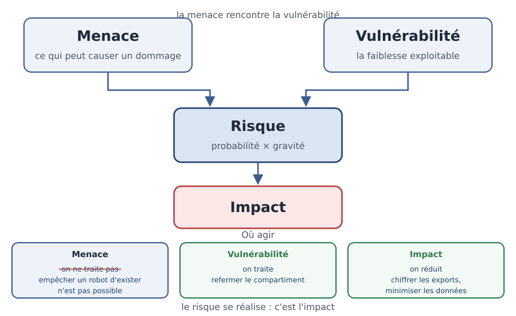

[← Chapitre précédent](02-securite-proportionnee.md) · [Sommaire](Readme.md) · [Chapitre suivant →](04-paysage-cyber.md)

# CID et vocabulaire du risque — les mots pour parler du risque

> Un caissier de supermarché peut voler dans la caisse, modifier le prix d'un
> article, ou bloquer la caisse pendant une heure. Trois gestes, trois problèmes,
> trois mesures différentes. Pour en parler sans se comprendre de travers, il faut
> d'abord s'accorder sur les mots.

**Durée de lecture :** 60 min · **Prérequis :** [Sécurité proportionnée](02-securite-proportionnee.md)

---

## Objectifs

À l'issue de ce chapitre, vous serez capable de :

- **Distinguer** les trois piliers de la sécurité — CID (Confidentialité, Intégrité, Disponibilité) — sur un incident concret.
- **Différencier** vulnérabilité, menace, risque et impact, et les relier dans le bon ordre.
- **Construire** une chaîne menace → vulnérabilité → risque → impact à partir d'un scénario.
- **Cartographier** la surface d'attaque d'une application.

---

## I. CID — trois problèmes, trois mesures

Revenons au caissier. Trois gestes malhonnêtes, trois natures de problème :

| Ce que fait le caissier | Le problème posé | Le pilier touché |
| --- | --- | --- |
| Il se sert dans la caisse | quelque chose a été pris par qui n'en avait pas le droit | **Confidentialité** |
| Il modifie le prix affiché sur une étiquette | une information est devenue fausse | **Intégrité** |
| Il bloque la caisse pendant une heure | le service n'est plus rendu aux clients | **Disponibilité** |

En informatique, c'est exactement la même chose, avec des données :

- **Confidentialité** — seules les personnes autorisées accèdent à l'information.
  Exemple : un fichier de paie consulté par un tiers, une base clients copiée.
- **Intégrité** — l'information est exacte, complète, et n'a pas été altérée sans
  droit. Exemple : un prix modifié dans la base, un export quotidien corrompu en
  route vers l'entrepôt de données.
- **Disponibilité** — l'information et le service sont accessibles au moment où
  on en a besoin. Exemple : une boutique en ligne injoignable pendant les soldes,
  un tableau de bord bloqué le jour du comité de direction.

> [!TIP]
> Pour qualifier une atteinte, posez trois questions : qui a vu ce qu'il ne
> devait pas (confidentialité), qu'est-ce qui a été modifié ou détruit
> (intégrité), qu'est-ce qui n'est plus accessible (disponibilité). Un incident
> répond souvent aux trois.

Un même incident touche rarement un seul pilier. Un **rançongiciel** (logiciel qui
chiffre les données puis réclame une rançon) en est l'exemple type : les données
sont illisibles (disponibilité), elles ont souvent été copiées avant d'être
chiffrées (confidentialité), et leur contenu est altéré (intégrité).

> 🧪 **Atelier rapide (5 min)**
>
> Un rançongiciel chiffre les serveurs d'une clinique : les dossiers patients
> deviennent illisibles, les rendez-vous sont annulés, et l'attaquant affirme
> avoir copié les dossiers avant de frapper. Pour chaque pilier CID, dites s'il
> est touché et pourquoi, en une phrase. Un pilier que vous jugez épargné doit
> être justifié lui aussi.

---

## II. Vulnérabilité, menace, risque, impact

Dans le langage courant, « risque » sert à tout. En sécurité, quatre mots
chacun une place précise :

- **Menace** — ce qui peut causer un dommage : un attaquant, un groupe criminel,
  un logiciel automatisé, un ancien employé mécontent, une erreur humaine.
- **Vulnérabilité** — la faiblesse que la menace peut exploiter : un défaut de
  code, une configuration oubliée, un mot de passe partagé, une procédure absente.
- **Risque** — ce qui peut arriver quand une menace rencontre une vulnérabilité.
  On le juge sur deux axes : sa **probabilité** et sa **gravité**.
- **Impact** — la conséquence concrète si le risque se réalise : activité
  arrêtée, données fuitées, clients touchés, sanction éventuelle.

La chaîne se lit toujours dans le même sens :



Prenons un cas concret, tiré d'une plateforme d'analyse de données. Des exports
quotidiens de ventes sont déposés dans un compartiment de stockage d'objet
(MinIO) ouvert par erreur sur Internet :

| Élément | Dans le cas |
| --- | --- |
| **Menace** | un robot automatisé qui balaye Internet à la recherche de compartiments mal configurés |
| **Vulnérabilité** | le compartiment d'exports est accessible sans authentification |
| **Risque** | fuite des exports de ventes, qui contiennent des coordonnées clients |
| **Impact** | notification aux personnes concernées, perte de confiance, sanction possible |

Cette chaîne n'est pas qu'un vocabulaire : elle indique **où agir**. On traite
rarement la menace (empêcher qu'un robot existe n'est pas possible), on traite la
vulnérabilité (refermer le compartiment), et on réduit l'impact (chiffrer les
exports, minimiser les données qu'ils contiennent).

> [!WARNING]
> Une « menace » n'est pas un risque, et un « risque » n'est pas un impact.
> Mélanger ces mots fait basculer une discussion technique dans un débat sans
> fin : chacun défend une mesure différente parce qu'il ne parle pas de la même
> chose.

---

## III. Surface d'attaque

La **surface d'attaque**, c'est l'ensemble de ce qu'un attaquant peut atteindre,
toucher ou interroger. Elle ne se limite pas à la page de connexion : elle
commence dès qu'un élément est joignable, visible, ou devinable.

Quatre familles à passer en revue :

1. **Les points d'entrée techniques** — API ouvertes, ports réseau, pages de
   connexion, fichiers téléchargeables, interfaces d'administration.
2. **Les données exposées** — messages d'erreur trop bavards, sauvegardes
   accessibles, fichiers de configuration, métadonnées.
3. **Les identités** — comptes oubliés, mots de passe par défaut, comptes de
   service trop puissants, comptes partagés.
4. **Les dépendances** — bibliothèques tierces non mises à jour, images de
   conteneurs périmées, services tiers abandonnés.

Un extrait suffit à voir le problème. Cette route d'API (FastAPI, en Python) est
parfaitement fonctionnelle — et parfaitement exposée :

```python
from fastapi import FastAPI

app = FastAPI()

# Surface d'attaque : cette route est joignable par quiconque connaît l'URL.
# Elle renvoie toutes les commandes, adresses de livraison comprises.
@app.get("/commandes")
def lister_commandes():
    return base.all("SELECT * FROM commandes")
```

Et la surface commence parfois avant même le code, dans un fichier oublié :

```yaml
# Fichier de configuration committé par erreur dans le dépôt Git :
# les identifiants de la base y sont en clair.
base:
  hote: db.exemple.fr
  utilisateur: app_prod
  mot_de_passe: mot-de-passe-en-clair
```

Cartographier sa surface d'attaque, c'est donc lister trois choses : ce qui est
**joignable**, ce qui est **visible**, et ce qui **permet d'aller plus loin** (un
compte, une clé, une donnée qui en révèle une autre). C'est le sujet de
l'exercice de ce bloc.

---

## IV. Aller plus loin

*Ces approfondissements sont facultatifs : ils ne sont jamais exigés pour terminer
la journée.*

- **RGPD (Règlement général sur la protection des données)** : le texte européen
  qui encadre le traitement des données personnelles. Il impose son propre
  vocabulaire — donnée personnelle, responsable de traitement, violation de
  données — que le [dernier chapitre de la journée](06-cadre-juridique-intro.md)
  détaillera.
- **CNIL (Commission nationale de l'informatique et des libertés)** : l'autorité
  française de contrôle. Ses fiches pratiques reprennent le vocabulaire du risque
  sous l'angle juridique.
- **ANSSI (Agence nationale de la sécurité des systèmes d'information)** : ses
  guides publics emploient les mêmes termes (actif, menace, vulnérabilité,
  impact) dans la méthode française d'analyse de risque EBIOS (Expression des
  Besoins et Identification des Objectifs de sécurité).

---

## Points clés

- **CID (Confidentialité, Intégrité, Disponibilité)** : trois problèmes
  différents, trois familles de mesures. Un même incident en touche souvent
  plusieurs.
- **Menace, vulnérabilité, risque, impact** : quatre mots précis, dans cet ordre.
  La chaîne menace → vulnérabilité → risque → impact montre où agir.
- On traite une **vulnérabilité** et on réduit un **impact** — rarement la menace
  elle-même.
- La **surface d'attaque** est tout ce qu'un attaquant peut atteindre : points
  d'entrée, données exposées, identités, dépendances.

---

[← Chapitre précédent](02-securite-proportionnee.md) · [Sommaire](Readme.md) · [Chapitre suivant →](04-paysage-cyber.md)
