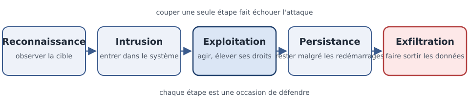

[← Chapitre précédent](03-cid-et-vocabulaire.md) · [Sommaire](Readme.md) · [Chapitre suivant →](05-modeles-de-securite.md)

# Le paysage de la cybersécurité — qui attaque, comment, et à quelle vitesse

> Un lycéen qui lance des attaques par curiosité, ou un groupe financé par un
> État qui travaille sur des mois. Deux menaces très différentes, deux défenses
> très différentes. Avant de se protéger, il faut savoir **qui l'on cherche à
> tenir éloigné** — et à quelle vitesse le jeu se joue.

**Durée :** ≈ 20 min (lecture ≈ 12 min + atelier 5 min + réflexion) · **Prérequis :** [Vocabulaire du risque](03-cid-et-vocabulaire.md)

---

## Objectifs

À l'issue de ce chapitre, vous serez capable de :

- **Associer** chaque type d'acteur malveillant à ses motivations et à ses moyens.
- **Décrire** les étapes d'une attaque avec la kill chain simplifiée.
- **Relier** chaque étape de la kill chain à une mesure de défense.
- **Analyser** pourquoi la vitesse de réaction décide de l'avantage entre attaquants et défenseurs.

---

## I. Les acteurs

Derrière le mot « pirate », il y a des réalités très différentes. Ce qui les
sépare : la **motivation** (pourquoi), les **moyens** (avec quoi), et le
**temps** qu'ils peuvent y consacrer.

| Acteur | Motivation | Moyens | Cibles typiques |
| --- | --- | --- | --- |
| **Le curieux** (script kiddie) | se prouver quelque chose, s'amuser | outils téléchargés, scans automatisés | sites peu protégés, défiguration |
| **Le cybercriminel** | l'argent | rançongiciels, revente de données, hameçonnage de masse | entreprises, hôpitaux, collectivités |
| **L'hacktiviste** | une idéologie, une protestation | défiguration, fuite de documents | organisations politiques, médias |
| **L'espion industriel** | un avantage commercial | campagnes ciblées, moissonnage prolongé | laboratoires, industriels, brevets |
| **L'APT (Advanced Persistent Threat)** | une stratégie d'État | moyens étendus, patience, outils sur mesure | infrastructures critiques, administrations |

Deux remarques utiles pour la suite :

- Les moyens montent vite avec la motivation. Un outil de curieux est bruyant et
  grossier ; une APT (Advanced Persistent Threat) prépare son intrusion pendant
  des mois et sait rester invisible.
- **L'attribution est difficile.** Savoir qu'une attaque a eu lieu est une chose ;
  savoir qui la pilote en est une autre, et les faux indices sont monnaie
  courante. On défend d'abord contre des **méthodes**, pas contre des noms.

> 🧪 **Atelier rapide (5 min)**
>
> Associez chaque scénario à l'acteur le plus probable, et justifiez en une
> ligne : (a) des cartes bancaires revendues sur un forum ; (b) des documents
> internes publiés pour protester ; (c) le site d'une mairie défiguré avec un
> outil téléchargé ; (d) les plans d'un prototype disparus après une campagne
> d'e-mails ciblée. Terminez en disant ce qui rend votre attribution
> **incertaine**.

---

## II. La kill chain simplifiée

Le terme **kill chain** (« chaîne d'attaque ») vient du vocabulaire militaire :
une opération réussie enchaîne des étapes, et couper une seule d'entre elles
suffit à faire échouer le reste. En version simplifiée, une attaque informatique
comporte cinq étapes :

| Étape | Ce que fait l'attaquant | Où se défendre |
| --- | --- | --- |
| **Reconnaissance** | observer : site web, profils professionnels, adresses e-mail publiées, dépôts de code | réduire ce qui est exposé, sensibiliser aux publications |
| **Intrusion** | entrer : hameçonnage, identifiants volés, faille publique non corrigée | authentification multi-facteurs, correctifs, filtrage |
| **Exploitation** | agir : exécuter du code, élever ses privilèges, atteindre d'autres systèmes | cloisonnement, moindre privilège, journalisation |
| **Persistance** | rester : créer un compte, planifier une tâche, installer une porte dérobée | revue des comptes, surveillance des changements |
| **Exfiltration** | sortir : copier les données vers l'extérieur, souvent en petites quantités | contrôle des flux sortants, chiffrement, détection des volumes anormaux |

Deux enseignements se dégagent de cette chaîne :

1. **La reconnaissance n'est pas anodine.** Une annonce de recrutement qui détaille
   la stack technique, un dépôt Git public, un profil professionnel complet : tout
   cela alimente l'étape suivante. La première étape se défend en réduisant ce
   qu'on publie.
2. **Chaque étape est une occasion de couper.** Une intrusion sans exploitation
   reste sans effet ; une exploitation sans persistance se voit plus vite. La
   défense n'a pas à gagner partout — elle doit gagner **une fois** sur la chaîne.

> [!TIP]
> Pour analyser un incident passé, reconstituez sa kill chain étape par étape, en
> remontant depuis l'impact. À chaque étape, demandez quelle mesure aurait coupé
> la chaîne ici : c'est votre liste de mesures à prioriser.

---

## III. La course patch / exploit

Quand une faille est publiée, deux courses s'engagent : le défenseur qui
**applique le correctif**, l'attaquant qui **écrit l'exploit**. Et la deuxième
course va plus vite.

L'exemple de **WannaCry** (mai 2017) reste la leçon la plus nette : la faille
utilisée avait été corrigée par l'éditeur dès mars 2017. En deux mois, un ver
automatisé l'a exploitée pour paralyser des hôpitaux, des entreprises et des
administrations dans le monde — celles qui n'avaient pas encore appliqué le
correctif. Le problème n'était pas la technique : c'était le **délai**.

Le même scénario s'est rejoué avec **Log4Shell** (décembre 2021), une faille
dans une bibliothèque de journalisation très répandue, identifiée
CVE-2021-44228 dans la nomenclature CVE (Common Vulnerabilities and Exposures) :
exploitée dans le monde entier quelques heures après sa publication, alors que
les correctifs mettaient des semaines à se déployer.

D'où trois réflexes :

- **Le temps de réaction compte plus que la perfection.** Un correctif appliqué
  en quelques heures vaut mieux qu'une protection idéale jamais déployée.
- **La fenêtre d'exposition se mesure.** Entre la publication d'un correctif et
  son application, le système est exposé : cette durée est un indicateur de
  sécurité à part entière.
- **L'IA (intelligence artificielle) accélère les deux
  camps.** Elle aide à générer des exploits, à tester des variantes et à
  automatiser les scans ; elle aide aussi à trier les alertes, à détecter les
  anomalies et à rédiger les correctifs. L'avantage reste au camp qui exécute le
  plus vite.

> [!DANGER]
> « Nous n'avons rien d'intéressant à voler » n'est pas une défense. Les
> attaques automatisées ne choisissent pas leur cible en fonction de son
> intérêt : elles choisissent ce qui est joignable et non corrigé.

---

## IV. Aller plus loin

> ⏭️ **Facultatif — pas exigé pour finir la journée.**

- **MITRE ATT&CK** — la base de référence des tactiques et techniques adverses.
  Le sigle se décompose en ATT (Adversarial Tactics, Techniques) et CK (Common
  Knowledge) ; il est maintenu par MITRE (organisme de recherche américain à but
  non lucratif). On y décrit les attaques par **comportements observables**, ce
  qui permet de comparer un incident à des méthodes déjà répertoriées.
- **ANSSI (Agence nationale de la sécurité des systèmes d'information)** et
  **DBIR (Data Breach Investigations Report, Verizon)** — le « Panorama de la
  cybermenace » de la première décrit chaque année les acteurs actifs en France ;
  le second sert à vérifier si les motifs d'attaque que vous redoutez sont ceux
  qui dominent réellement. Ressources déjà citées au
  [chapitre 1](01-pourquoi-securiser.md).

---

## Points clés

- Les acteurs se distinguent par leur **motivation**, leurs **moyens** et leur
  **temps** — deux défenses très différentes pour deux menaces très différentes.
- La **kill chain** simplifiée enchaîne reconnaissance, intrusion, exploitation,
  persistance et exfiltration : couper une seule étape fait échouer l'attaque.
- La **course patch / exploit** se joue sur la vitesse : un correctif appliqué
  vite vaut mieux qu'une protection parfaite jamais déployée.
- L'attribution d'une attaque est difficile : on défend contre des **méthodes**,
  pas contre des noms.

---

## 🧠 Vérifiez vos acquis

*Formatif, jamais noté. Répondez sans relire le chapitre, puis cochez. Les réponses sont juste après le séparateur : ce qui compte est de repérer où vous vacillez, pas de faire 5 sur 5.*

**1.** Qu'est-ce qui distingue principalement un curieux (script kiddie) d'une APT (Advanced Persistent Threat) ?

- A. Le premier cherche de l'argent, la seconde une idéologie
- B. Les moyens et le temps consacrés : outils téléchargés et scans bruyants d'un côté, des mois de préparation et une intrusion invisible de l'autre
- C. Le premier agit depuis l'étranger, la seconde depuis le pays
- D. Le premier s'attaque aux sites, la seconde uniquement aux banques

- [ ] ✓ je savais

**2.** Après être entré, l'attaquant crée un compte discret et planifie une tâche. À quelle étape de la kill chain cela correspond-il ?

- A. La reconnaissance
- B. L'exploitation
- C. La persistance
- D. L'exfiltration

- [ ] ✓ je savais

**3.** Que dit le chapitre de l'IA (intelligence artificielle) dans la course patch / exploit ?

- A. Elle donne un avantage décisif aux défenseurs, qui détectent plus vite
- B. Elle accélère les deux camps, et l'avantage reste au camp qui exécute le plus vite
- C. Elle rend les correctifs inutiles, les failles étant corrigées avant d'être publiées
- D. Elle ne concerne que la génération d'exploits, jamais la défense

- [ ] ✓ je savais

**4.** WannaCry (mai 2017) a paralysé des hôpitaux avec une faille corrigée par l'éditeur dès mars 2017. Qu'est-ce qui a fait défaut ?

- A. La technique : la faille ne pouvait pas être corrigée plus tôt
- B. Le délai : la fenêtre entre la publication du correctif et son application
- C. L'absence de correctif, l'éditeur n'ayant rien publié
- D. Le manque d'outils de détection dans les hôpitaux

- [ ] ✓ je savais

**5.** *Question ouverte (2-3 lignes).* Un élu déclare : « notre mairie n'a rien d'intéressant à voler ». Répondez en vous appuyant sur le chapitre, puis citez une mesure qui coupe la chaîne à l'étape de la reconnaissance.

- [ ] ✓ je savais

---

### Réponses

**1. B.** Ce qui sépare les acteurs, c'est la motivation, les moyens et le temps qu'ils peuvent y consacrer — et les moyens montent vite avec la motivation.
**Pourquoi :** un outil de curieux est bruyant et grossier, une APT prépare son intrusion pendant des mois et sait rester invisible ; les cibles ne sont pas les mêmes non plus (infrastructures critiques et administrations pour une APT).

**2. C.** Rester : créer un compte, planifier une tâche, installer une porte dérobée — c'est la persistance.
**Pourquoi :** la défense correspondante est la revue des comptes et la surveillance des changements, et une exploitation sans persistance se voit plus vite.

**3. B.** L'IA aide à générer des exploits, à tester des variantes et à automatiser les scans, mais aussi à trier les alertes, à détecter les anomalies et à rédiger les correctifs.
**Pourquoi :** le temps de réaction compte plus que la perfection : l'avantage reste au camp qui exécute le plus vite.

**4. B.** Le problème n'était pas la technique mais le délai : deux mois se sont écoulés entre le correctif et l'exploitation par un ver automatisé, au détriment de ceux qui ne l'avaient pas encore appliqué.
**Pourquoi :** la fenêtre d'exposition, entre la publication d'un correctif et son application, est un indicateur de sécurité à part entière.

**5.** Attendu : les attaques automatisées ne choisissent pas leur cible selon son intérêt, elles prennent ce qui est joignable et non corrigé ; à l'étape de la reconnaissance, on réduit ce qui est exposé (une annonce de recrutement qui détaille la stack technique, un dépôt Git public, un profil professionnel complet) et on sensibilise aux publications.
**Pourquoi :** la reconnaissance alimente l'étape suivante, et la défense n'a pas à gagner partout : elle doit gagner une fois sur la chaîne.

---

[← Chapitre précédent](03-cid-et-vocabulaire.md) · [Sommaire](Readme.md) · [Chapitre suivant →](05-modeles-de-securite.md)
