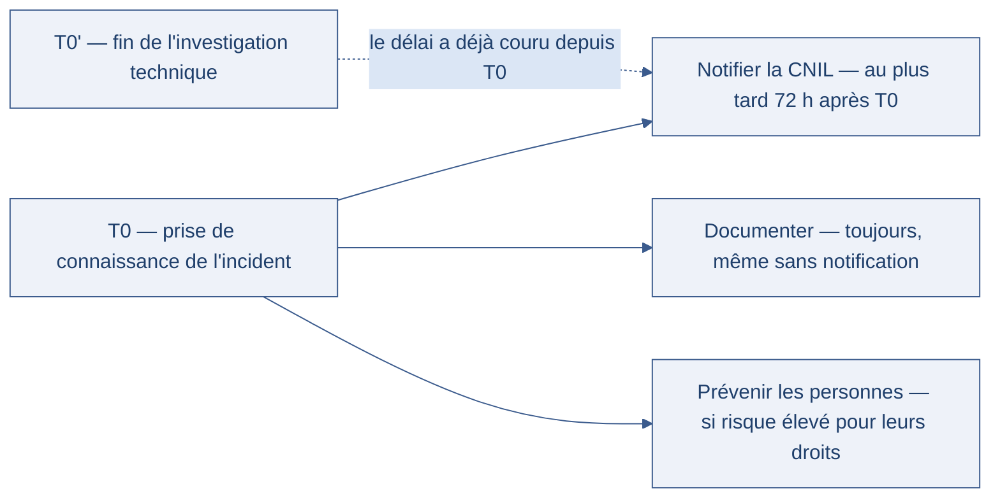

[← Chapitre précédent](05-modeles-de-securite.md) · [Sommaire](Readme.md) · [Chapitre suivant →](A-Glossaire-et-ressources.md)

# Cadre juridique introductif — le RGPD (Règlement général sur la protection des données) comme contrainte technique

> Une boutique en ligne conserve des adresses e-mail « au cas où », depuis des
> années, sans savoir pourquoi — et reçoit un courrier de la CNIL (Commission
> nationale de l'informatique et des libertés). La loi n'est pas un frein à
> contourner : c'est un cadre qui se traduit en **contraintes techniques**, aussi
> concrètes qu'une règle de pare-feu.

**Durée :** ≈ 25 min (lecture ≈ 12 min + atelier 8 min + réflexion) · **Prérequis :** [Modèles de défense](05-modeles-de-securite.md)

---

## Objectifs

À l'issue de ce chapitre, vous serez capable de :

- **Identifier** les principes du RGPD applicables à une application.
- **Repérer** les données personnelles dans un schéma de base de données.
- **Décrire** la procédure à suivre en cas de violation de données personnelles.
- **Relier** chaque obligation légale à une contrainte technique ou organisationnelle.

---

## I. Le RGPD en 5 minutes

Le **RGPD** est le texte européen qui encadre le traitement des données
personnelles. Il s'applique dès qu'on traite des données relatives à des
personnes identifiées ou identifiables — quel que soit le pays où se trouve le
serveur.

### Qu'est-ce qu'une donnée personnelle ?

Tout ce qui identifie une personne, directement ou indirectement : nom, adresse
e-mail, numéro de téléphone, mais aussi identifiant de session, adresse IP
(Internet Protocol, le protocole d'adressage d'Internet), historique d'achats,
géolocalisation. Un identifiant technique « anonyme » qui permet de retrouver
une personne est une donnée personnelle.

### Les principes qui dérangent (et qui structurent tout)

| Principe | Ce qu'il impose | Traduction technique |
| --- | --- | --- |
| **Finalité** | collecter pour une raison précise, annoncée | un champ de formulaire a une raison d'être documentée |
| **Minimisation** | ne collecter que le strict nécessaire | supprimer les champs « on ne sait jamais » |
| **Durée de conservation** | garder le temps utile, puis effacer | purge planifiée, durée par table |
| **Exactitude** | des données à jour | mise à jour et rectification possibles |
| **Sécurité** | protéger les données | chiffrement, contrôle des accès, journalisation |
| **Transparence** | informer les personnes | mentions lisibles, politique de confidentialité |

Deux rôles à distinguer, parce qu'ils n'engagent pas les mêmes obligations :

- le **responsable de traitement** décide des finalités — l'entreprise qui vend ;
- le **sous-traitant** traite pour son compte — l'hébergeur, le prestataire
  d'envoi de courriels, l'éditeur du logiciel de gestion.

Pour un développeur, la conséquence est directe : choisir un prestataire, c'est
encadrer un sous-traitant — contrat, instructions, sécurité.

### Les droits des personnes

Accès, rectification, effacement, portabilité, opposition. Concrètement, une
application qui ne sait pas **retrouver** les données d'une personne, les
**corriger** ou les **supprimer** sur demande ne respecte pas le texte — quelles
que soient ses belles intentions.

> [!TIP]
> Posez-vous la question dès la conception du schéma de base : « si une personne
> demande l'effacement de ses données, sais-je où elles sont toutes ? » Les
> copies, exports et sauvegardes comptent — c'est là que la réponse se complique.

---

## II. Que faire en cas de violation ?

Une **violation de données personnelles**, c'est un accès, une perte, une
altération ou une divulgation non autorisée. Un rançongiciel qui copie une base
clients en est une ; un export oublié sur un serveur public aussi.

La procédure tient en trois gestes :

1. **Notifier** l'autorité de contrôle — la **CNIL** en France — dans les **72
   heures** après en avoir pris connaissance, sauf si la violation ne fait pas
   courir de risque aux personnes.
2. **Documenter** l'incident : ce qui s'est passé, quelles données sont
   concernées, quelles mesures ont été prises. Même quand on ne notifie pas, on
   écrit.
3. **Prévenir les personnes concernées** quand la violation fait courir un risque
   élevé pour leurs droits — de façon claire, sans jargon.

Le point qui surprend toujours : le délai court à partir de la **connaissance**
de l'incident, pas de sa découverte technique complète. Une organisation qui
met trois semaines à comprendre ce qui s'est passé, puis notifie, est hors délai.

L'horloge ci-dessous montre pourquoi le point de départ compte plus que la
durée : le délai court dès la connaissance de l'incident, pas dès la fin de
l'analyse technique.

> 🧪 **Atelier rapide (8 min)**
>
> Voici les colonnes de la table `commandes` d'une boutique en ligne :
> `id`, `client_nom`, `client_email`, `adresse_livraison`, `telephone`,
> `date_commande`, `montant_total`, `code_promo_utilise`, `ip_client`.
>
> Repérez quelles colonnes sont des **données personnelles**, lesquelles
> méritent une attention particulière, et lesquelles n'en sont pas. Justifiez
> chaque choix en une ligne — et dites ce que vous feriez des colonnes
> superflues.

---

### Exercice bonus — Identifier les obligations RGPD sur un cas type (30 min, facultatif)

**Contexte.**

Une chaîne de magasins de sport lance son programme de fidélité. Le projet
comporte :

- une **carte de fidélité** : nom, prénom, adresse e-mail, date de naissance,
  historique d'achats sur les 5 dernières années ;
- une **application mobile** : géolocalisation des magasins visités (l'utilisateur
  doit donner son accord), notifications de promotions ;
- une **newsletter mensuelle**, envoyée à tous les clients, avec un lien de
  désinscription en bas de page ;
- une règle de conservation résumée ainsi : « les données sont gardées tant que
  le compte est actif », sans autre précision.

Quelques semaines après le lancement, une copie de la base de fidélité est
retrouvée sur un serveur tiers qui n'a rien à voir avec le projet. La direction
sait qu'un délai de notification de **72 heures** s'applique en cas de violation
de données personnelles — mais pas à qui notifier, ni quelles autres obligations
le projet aurait dû respecter depuis le début.

Vous êtes consulté en indépendant. Personne ne vous donnera la liste des
réponses attendues : c'est le principe de ce défi.

1. **Lister les traitements** de données personnelles du cas, et dire pour chacun
   s'il repose sur une **finalité claire** — c'est-à-dire une raison annoncée à
   la personne concernée.
2. **Repérer les manquements probables** aux principes du RGPD : minimisation,
   finalité, durée de conservation, transparence, consentement. Appuyez-vous sur
   les faits du contexte, pas sur des suppositions.
3. **Traduire chaque obligation retenue en contrainte concrète** — technique ou
   organisationnelle — en une ligne : ce qu'il faut faire, où, et à quel moment.
4. **Rédiger le plan d'action de l'incident** : qui prévenir, quoi documenter,
   dans quel ordre. Tenez compte du délai annoncé dans le contexte.

**Avant d'ouvrir la correction**, vérifiez que :

- [ ] Chaque traitement listé indique les données concernées et sa finalité.
- [ ] Chaque manquement cité renvoie à un principe précis du RGPD et à un fait du contexte.
- [ ] Chaque obligation est traduite en une contrainte concrète (ce qu'on fait, où, quand).
- [ ] Mon plan d'action nomme l'autorité de contrôle, le registre à tenir, et les personnes à prévenir.
- [ ] J'ai situé le point de départ du délai de notification.

Voir la correction

Pour un défi, pas de pas-à-pas : une **réponse de référence** et une **grille de vérification**. Confrontez votre travail aux points ci-dessous — d'autres formulations se défendent, à condition de s'appuyer sur les faits du contexte.

**Réponse de référence.**

**Les traitements et leurs finalités.**

| Traitement | Données | Finalité déclarable | Avis |
| --- | --- | --- | --- |
| Carte de fidélité | nom, prénom, e-mail, date de naissance, historique d'achats | gérer le programme : cumul d'avantages, suivi des points | recevable, sous réserve de la minimisation |
| Application mobile | géolocalisation, préférences de notifications | proposer les magasins et les offres pertinentes | recevable si l'accord est révocable et la donnée minimisée |
| Newsletter | adresse e-mail | informer des actualités et promotions | recevable si l'inscription est volontaire et révocable |

**Ce qui cloche dès cette lecture :** la date de naissance n'a de finalité que si
des avantages anniversaires sont réellement prévus ; sinon, c'est une collecte
sans raison — le premier réflexe est de la supprimer, pas de la « sécuriser ».

**Les manquements probables, principe par principe.**

- **Minimisation** — la date de naissance sans finalité, et une géolocalisation
  plus précise que ce que le service exige (l'historique complet des magasins
  visités n'est pas nécessaire pour proposer le magasin le plus proche).
- **Finalité** — les « notifications de promotions » ne sont pas reliées de façon
  explicite au programme de fidélité : une finalité doit être annoncée, pas
  déduite.
- **Durée de conservation** — « tant que le compte est actif » n'est pas une
  durée : aucun critère d'activité n'est défini, aucune purge n'est prévue. C'est
  le manquement le plus fréquent, et le plus facile à corriger.
- **Transparence** — rien n'indique que les personnes ont été informées des
  traitements, ni des éventuels destinataires des données.
- **Consentement** — la géolocalisation et la newsletter exigent un accord libre,
  révocable, et **prouvable** : la preuve du consentement est une donnée à
  conserver elle aussi.

**Traduction en contraintes concrètes.**

| Obligation | Contrainte technique ou organisationnelle |
| --- | --- |
| Minimisation | supprimer le champ de date de naissance s'il n'a pas de finalité ; borner la géolocalisation à la donnée utile |
| Durée de conservation | définir une durée par table, une tâche de purge planifiée et journalisée, un critère d'inactivité pour les comptes |
| Transparence | une mention au moment de la collecte, une politique de confidentialité par traitement |
| Consentement | case non pré-cochée, retrait en un clic, preuve du consentement stockée avec sa date et la version de la mention |
| Sécurité | chiffrement de la base, contrôle des accès, journalisation, et revue des copies de données hors du périmètre déclaré |
| Droits des personnes | possibilité de retrouver, corriger et effacer les données d'une personne sur demande |

**Le plan d'action de l'incident.**

- **Confinement et constat** — couper l'accès du serveur tiers, établir ce que
  contenait la copie, quand elle a été faite, et par qui elle était accessible.
- **Notification à la CNIL (Commission nationale de l'informatique et des
  libertés)** — dans les **72 heures** à partir du moment où l'organisation a
  **pris connaissance** de la violation, pas à partir de la fin de l'investigation.
- **Registre des violations** — documenter les faits, les données concernées, les
  mesures prises. Même quand la notification n'est pas due, l'écriture est
  obligatoire.
- **Information des personnes** — quand le risque pour leurs droits est élevé :
  ici, des données d'identité et d'achats fuitées exposent au hameçonnage ciblé,
  l'information doit être claire et dire quoi faire.
- **Revue de la cause** — une copie de base trouvée sur un serveur tiers révèle
  un flux ou un prestataire non encadré : c'est cette brèche-là qu'il faut
  refermer, pas seulement l'incident.

**Grille de vérification.**

Votre travail tient la route si vous cochez l'essentiel ci-dessous :

- [ ] Chaque traitement est relié à une finalité annoncée aux personnes concernées.
- [ ] La date de naissance et la géolocalisation sont traitées sous l'angle de la minimisation, pas seulement de la sécurité.
- [ ] La durée de conservation est critiquée comme un manquement à part entière — et non renvoyée à « plus tard ».
- [ ] Le plan d'action nomme la CNIL, le registre, et l'information des personnes.
- [ ] Le délai de 72 heures est rattaché à la **connaissance** de l'incident.
- [ ] Au moins une contrainte concrète est proposée par obligation retenue.

**Erreurs fréquentes.**

- **Traiter le cas comme un problème de sécurité uniquement** — chiffrer la base
  ne règle ni la minimisation, ni la durée de conservation, ni l'information des
  personnes.
- **Inventer des obligations hors contexte** — ce défi porte sur les faits
  donnés ; ajouter des hypothèses éloigne de l'exercice.
- **Oublier la preuve du consentement** — un accord qu'on ne peut pas prouver
  n'est pas un consentement recevable.
- **Confondre notification et information** — la CNIL reçoit la notification ;
  les personnes concernées reçoivent l'information. Les deux ne vont pas
  toujours ensemble, et les délais diffèrent.

**Points à retenir.**

- Les obligations RGPD se lisent **dans le projet**, pas dans un texte à part :
  chaque champ de formulaire, chaque durée de conservation, chaque destinataire
  est une décision.
- **Minimiser** est plus efficace que protéger : une donnée qu'on n'a pas
  collectée ne peut ni fuir, ni dépasser sa durée de conservation.
- En cas de violation : **confiner**, **notifier** la CNIL dans les 72 heures à
  partir de la connaissance, **documenter** toujours, **informer** les personnes
  si le risque est élevé.
- La cause d'un incident est souvent un **flux oublié** ou un **prestataire non
  encadré** : c'est là que le travail de fond se fait.

---

## III. Les transversales

Le RGPD n'est pas le seul cadre à croiser. Deux autres préoccupations
reviennent dans les cahiers des charges, et se traitent au même moment : à la
conception.

### L'accessibilité PSH

**PSH (Personnes en Situation de Handicap)** — l'accessibilité rend un service
utilisable par tous : contrastes suffisants, navigation au clavier, textes
alternatifs pour les images, formulaires explicités. Les référentiels de
référence sont le **RGAA (Référentiel général d'amélioration de l'accessibilité)**
en France, et les **WCAG (Web Content Accessibility Guidelines)** au niveau
international.

Elle est **obligatoire** pour certains services (secteur public, grandes
entreprises) et **toujours utile** ailleurs : un service accessible est plus
lisible pour tout le monde, y compris sur un écran petit ou dans une pièce
éclairée.

### L'éco-conception

Alléger les pages, réduire le poids des transferts, limiter les traitements
inutiles : l'éco-conception numérique réduit la consommation d'énergie — et
améliore en général la performance et l'accessibilité. Elle entre parfois dans
les obligations d'achat public, et toujours dans la durée de vie du service.

> [!WARNING]
> Une transversale plaquée après coup coûte dix fois plus cher qu'une
> transversale intégrée à la conception. Accessibilité, éco-conception et
> protection des données se décident au moment du schéma de base et des maquettes
> — pas au moment de la recette.

---

## IV. Aller plus loin

> ⏭️ **Facultatif — pas exigé pour finir la journée.**

- **Le rôle de la CNIL** : elle contrôle, elle sanctionne, mais elle accompagne
  aussi — ses fiches pratiques et ses référentiels détaillent les bonnes
  configurations pour des cas courants (vidéosurveillance, cookies, ressources
  humaines).
- **Les amendes** : le texte prévoit des sanctions à la hauteur du manquement —
  jusqu'à 20 millions d'euros ou une part du chiffre d'affaires mondial. Les
  décisions publiées montrent surtout que les manquements reprochés sont
  ordinaires : durée de conservation non définie, information des personnes
  absente, sécurité insuffisante.
- **Le DPO (délégué à la protection des données)** : la personne désignée pour
  suivre ces obligations au quotidien. Dans une petite structure, le rôle existe
  quand même — il est simplement porté par une personne déjà en poste.

---

## Points clés

- Le **RGPD** s'applique dès qu'on traite des données personnelles : c'est une
  contrainte technique, pas un sujet « juridique à part ».
- Les principes à traduire en code : **finalité, minimisation, durée de
  conservation, exactitude, sécurité, transparence**.
- En cas de violation : **notifier** la CNIL dans les **72 heures**, **documenter**
  toujours, **prévenir** les personnes quand le risque est élevé.
- **Accessibilité PSH** et **éco-conception** se décident à la conception — au
  moment du schéma de base et des maquettes.

---

## 🧠 Vérifiez vos acquis

*Formatif, jamais noté. Répondez sans relire le chapitre. Les réponses se déplient juste après le séparateur : ce qui compte est de repérer où vous vacillez, pas de faire 5 sur 5.*

**1.** Un formulaire collecte le numéro de téléphone « on ne sait jamais ». Quel principe du RGPD est en cause, et quelle en est la traduction technique ?

- A. La finalité : documenter la raison d'être de chaque champ
- B. La minimisation : supprimer les champs collectés par précaution
- C. La transparence : informer les personnes en langage clair
- D. L'exactitude : permettre la rectification en ligne

**2.** Lequel de ces éléments est une donnée personnelle alors qu'il paraît purement technique ?

- A. Le montant total d'une commande
- B. Un identifiant de session
- C. Le code promo utilisé
- D. La date de la commande

**3.** À partir de quel moment court le délai de notification de 72 heures ?

- A. De la découverte technique complète de l'incident
- B. De la connaissance de l'incident
- C. De la première réclamation d'une personne concernée
- D. De la publication de la faille exploitée

**4.** L'hébergeur qui stocke la base de la boutique en ligne est, au sens du RGPD :

- A. responsable de traitement, puisqu'il détient physiquement les données et en assure la disponibilité
- B. sous-traitant, puisqu'il traite les données pour le compte de l'entreprise qui vend
- C. hors du champ du texte, puisqu'il ne vend rien aux clients et n'a pas de relation directe avec eux
- D. l'autorité de contrôle des opérations de la boutique, au même titre qu'un prestataire d'audit externe

**5.** *Question ouverte (2-3 lignes).* Un collègue propose de traiter l'accessibilité et la purge des données « à la recette, à la fin du projet ». Répondez en vous appuyant sur le chapitre, et citez les deux référentiels d'accessibilité qu'il mentionne.

---

Vérifier ses réponses

### Réponses

**1. B.** La minimisation impose de ne collecter que le strict nécessaire, ce qui se traduit par la suppression des champs « on ne sait jamais ».
**Pourquoi :** la finalité est le principe voisin — collecter pour une raison précise et annoncée — mais ici c'est l'absence de besoin qui est en cause, et donc la suppression du champ.

**2. B.** Une donnée personnelle est tout ce qui identifie directement ou indirectement : le chapitre cite l'identifiant de session, l'adresse IP, l'historique d'achats ou la géolocalisation.
**Pourquoi :** un identifiant technique « anonyme » qui permet de retrouver une personne est une donnée personnelle, ce qui surprend souvent côté développement.

**3. B.** Le délai court à partir de la connaissance de l'incident, pas de sa découverte technique complète.
**Pourquoi :** une organisation qui met trois semaines à comprendre ce qui s'est passé, puis notifie, est hors délai — et l'on documente de toute façon, même quand on ne notifie pas.

**4. B.** Le responsable de traitement décide des finalités (l'entreprise qui vend) ; le sous-traitant traite pour son compte : hébergeur, prestataire d'envoi de courriels, éditeur du logiciel de gestion.
**Pourquoi :** pour un développeur, choisir un prestataire, c'est encadrer un sous-traitant — contrat, instructions, sécurité.

**5.** Attendu : une transversale plaquée après coup coûte dix fois plus cher qu'une transversale intégrée à la conception ; l'accessibilité PSH (Personnes en Situation de Handicap) et l'éco-conception se décident au moment du schéma de base et des maquettes ; les référentiels sont le RGAA (Référentiel général d'amélioration de l'accessibilité) en France et les WCAG (Web Content Accessibility Guidelines) à l'international.
**Pourquoi :** l'accessibilité est obligatoire pour certains services (secteur public, grandes entreprises) et toujours utile ailleurs, et la protection des données se traduit en contraintes techniques dès la conception du schéma de base.

---

[← Chapitre précédent](05-modeles-de-securite.md) · [Sommaire](Readme.md) · [Chapitre suivant →](A-Glossaire-et-ressources.md)
